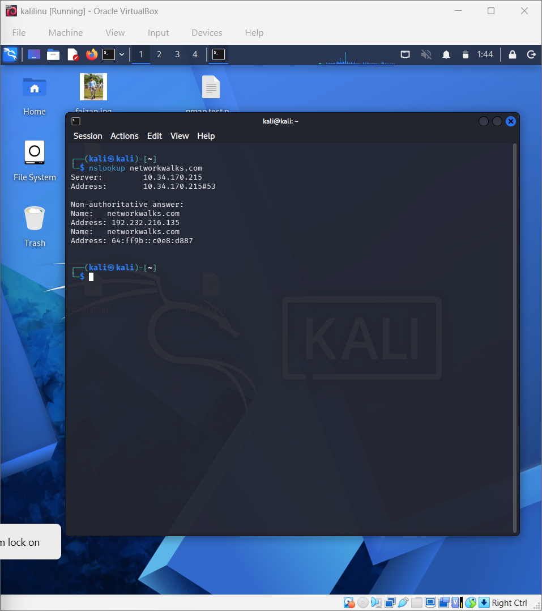
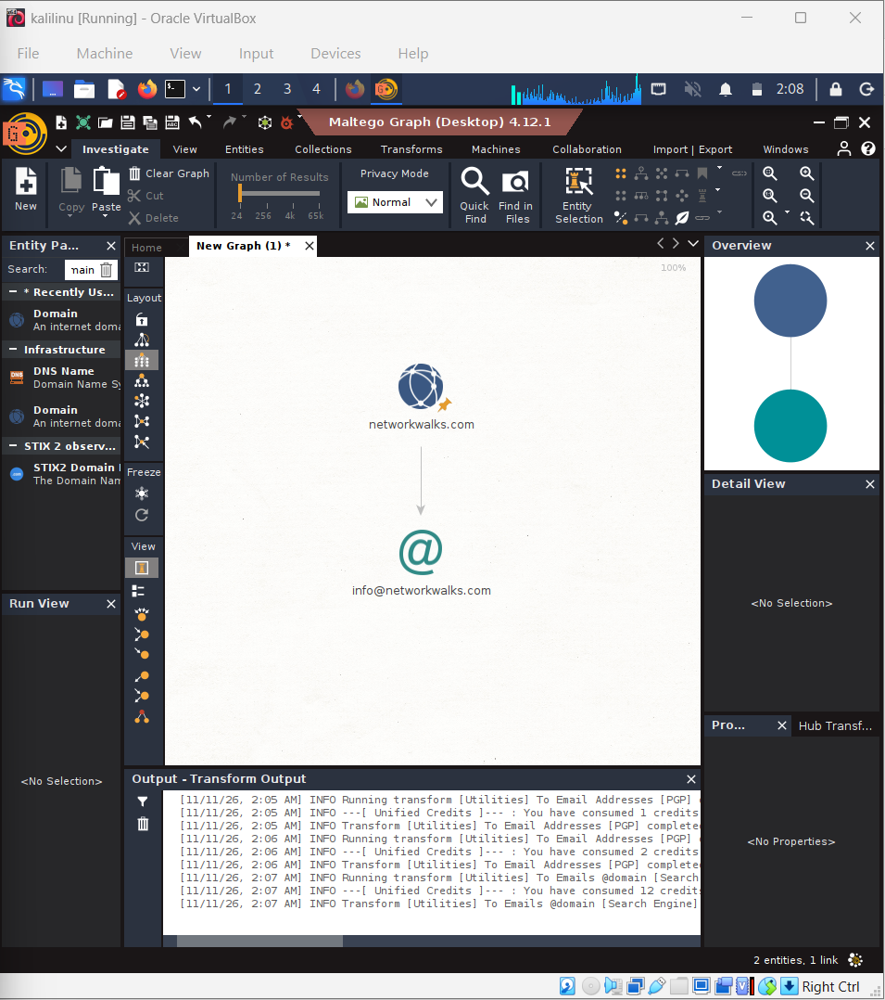
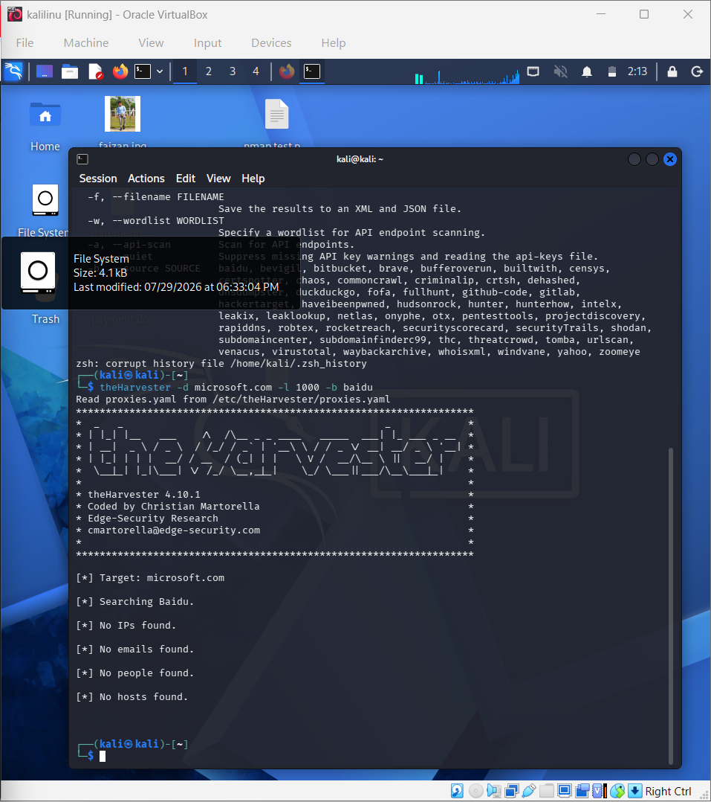
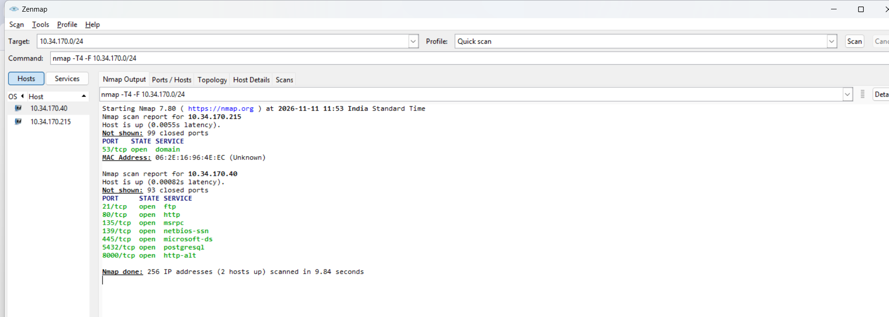

# 🔐 Networkwalks – Week 2 Cybersecurity Practical

  
  
  

## 👨‍💻 Author Information

- **Name:** Faizan Shaikh
- **Program:** Cybersecurity
- **Batch:** B084 – Networkwalks
- **Week:** 02
- **Date:** 12 November 2026

---

## 📌 Project Overview

This repository contains my Week 2 cybersecurity practical activities focused on **Reconnaissance, Footprinting, Information Gathering, and Network Scanning**.

I worked with different Kali Linux tools and security utilities to understand how publicly available information is collected and how network hosts and services are identified.

## 🎯 Phases Covered

| Phase | Description |
|---|---|
| 🔎 Phase 1 | Reconnaissance & Footprinting |
| 🌐 Phase 2 | Scanning & Network Discovery |

---

## 🛠️ Practical Activities

### 🔹 W2-PM1: Footprinting with Multiple Kali Tools

Used six different tools to perform basic footprinting and information gathering on the authorized target.

**Tools Used:**
- WHOIS
- WhatWeb
- NSLookup
- CURL
- Wafw00f
- DNSRecon

**Objective:** Understand domain information, DNS records, website technologies, and HTTP responses.

### 🔹 W2-PM2: GHDB-Based Footprinting

Explored Google Hacking Database (GHDB) to understand how search operators can identify publicly indexed information.

**Objective:** Learn about search-engine-based information discovery and potential information exposure.

### 🔹 W2-PM3: Maltego-Based Footprinting

Used Maltego for visual link analysis and to understand relationships between different entities.

**Objective:** Visualize information and connections collected during reconnaissance.

### 🔹 W2-PM4: theHarvester-Based Footprinting

Used theHarvester to collect publicly available information associated with the authorized domain.

**Objective:** Understand how email addresses, hostnames, and subdomain information can be collected.

### 🔹 W2-PM5: Zenmap-Based Network Scanning

Used Zenmap (Nmap GUI) to perform network discovery and identify live hosts, open ports, and services.

**Scan Details:**

| Parameter | Result |
|---|---|
| Target / Subnet | `10.34.170.0/24` |
| Scan Profile | Quick Scan |
| Live Hosts | 2 |
| Total IPs Scanned | 256 |
| Scan Duration | 9.84 seconds |

**Discovered Hosts:**

| IP Address | Open Ports / Services |
|---|---|
| `10.34.170.40` | 21 FTP, 80 HTTP, 135 MSRPC, 139 NetBIOS-SSN, 445 Microsoft-DS, 5432 PostgreSQL, 8000 HTTP-ALT |
| `10.34.170.215` | 53 DNS |

---

## 📸 Practical Screenshots

### 1️⃣ W2-PM1 – Multiple Kali Tools

### 3️⃣ W2-PM3 – Maltego

### 4️⃣ W2-PM4 – theHarvester

### 5️⃣ W2-PM5 – Zenmap

---

## 📚 Learning Outcomes

- Learned different footprinting techniques.
- Practised information gathering using Kali Linux tools.
- Explored Google Hacking Database (GHDB).
- Performed visual reconnaissance using Maltego.
- Collected public information using theHarvester.
- Identified live hosts, open ports, and services using Zenmap.
- Understood the importance of authorized security testing.

---

## ⚠️ Disclaimer

All activities were performed for educational purposes in an authorized lab environment. Testing should only be conducted on systems and networks where proper permission has been granted.

---

## 👨‍💻 Connect With Me

**Faizan Shaikh**

Cybersecurity Learner | VAPT | SOC Analyst

🔗 **LinkedIn:** [Connect with me](https://www.linkedin.com/in/faizan-shaikh-099803378/)

---

  <b>🚀 Keep Learning | Keep Practising | Keep Securing 🚀</b>

